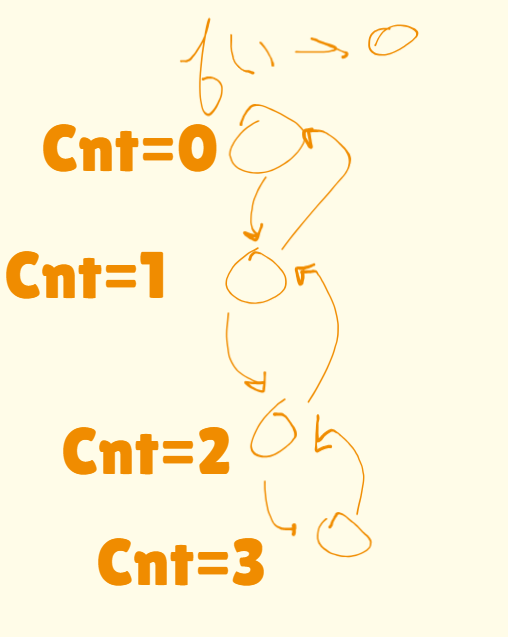

## Recursion
When a functions calls itself until a program until a specifiedd condition  is met
### Base Condition
When we need to stop the recursion then we specify a condition that if a particular condition has met then return the call and then it would stop the further lines of code execution and hence recursion is paused
### stack oVerflow/stack space
if the recursion is continued then the function calls like in the below example see
void print()
{
    std::cout<<1<<std::endl;
    print()
}

here in the above function we are not specifying a condition neither we are returning something so when we do recursion what will happen here is since we are calling the function but the function call will never be completed if we dont return something in the sense that if we dont end the  call then thewe function calls here in line 2 of the print() function would be stored in the memory stack and then it would keep on piling up until the memory is not avaliable to store the more unexecuted function calls hence what we do is that we store the function calls and if not executed then it will break the program so we specify a base condition to stop recursion

### Recursion Tree
it is the just the representation of the function calls 
for e.g->
int cnt = 0;
void print_count()
{
    if(cnt==3) return;
    std::cout<<cnt++<<std::endl;
    print_count()
}

here i am calling the print_count() function until the global variable cont becomes 3 then it will return the executed function and the recursion would end it would be as per the below pic

